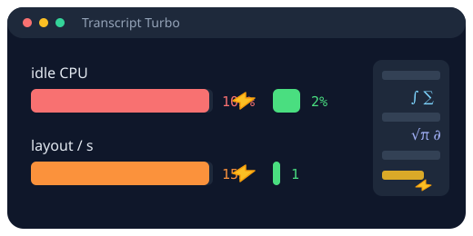

# dsh-transcript-turbo



Render acceleration for long, formula-heavy conversations in the DeepSeek Harness web UI.
Client-only bundle: injects one passive stylesheet, nothing else — no timers, no listeners,
no React, no slots. Disable the plugin in Plugin Manager to remove it completely.

> **中文**：让超长、含大量公式的对话保持流畅。视口外的消息块不再参与样式重算与布局，
> 状态点动画换成近零开销的呼吸闪烁。实测空闲主线程 26–105% → 1–2%。四个开关在
> 「插件 → 转录加速」详情页，改了即时生效；不碰你的皮肤（鲸鱼彩虹条降噪为可选开关，
> 默认关闭）。

## What it does

1. **Transcript containment.** Message blocks (`_flowItem`) and tool rows (`BE0jCW_root`)
   inside the transcript scroll container get `content-visibility:auto` with a remembered
   intrinsic size. Blocks scrolled away from the viewport stop participating in style
   recalculation, layout, and paint. Cost scales with the visible viewport instead of
   transcript length — the difference grows with message count, long code blocks, and
   dense KaTeX formula sets.
2. **Spinner quieting.** The app's status-dot spinners animate an SVG `transform` and
   `stroke-dash` every frame. On a 155 Hz display that forces ~155 style recalcs + layouts
   per second *while completely idle*. The plugin freezes the SVG parts and swaps in a
   compositor-only opacity pulse on the wrapper — the "working…" signal stays visible.
3. **Shimmer freezing.** Tool-row shimmer sweeps (`translate` keyframes) keep running at
   frame rate even when scrolled offscreen. They become a static highlight.
4. **Self-check (v0.2.0).** Three seconds after load the module verifies its own rules
   actually matched (`cv:auto` on a real flow item) and reports one console line —
   `info` when healthy, `warn` when an app update has renamed the classes the selectors
   rely on. The same object is kept on `window.__dshTranscriptTurbo` for probing.
5. **Configuration switches (v0.5.0).** The bundle's row in Plugin Manager carries a
   configuration form with four volatile switches — they apply instantly, without
   restarting anything: `containment`, `spinnerQuiet`, `shimmerFreeze`, and an
   opt-in `whaleRainbow` (see Honest limits).

## Measured (dsh-desktop 0.2.2-rc.5, Chromium 152, 2560×1440@155 Hz)

A. **Idle, mixed transcript (300+ messages, no formulas):**

| metric (idle) | before | after |
|---|---|---|
| main-thread busy | 26–29% of one core | **1–2%** |
| layout count | 155/s | **~1/s** |
| style recalcs | 155/s | **~19/s** (opacity pulse only) |

No regression: typing queue ~3 ms / paint ~5.5 ms; scroll p50 6.5 ms, no frame > 16 ms.

B. **Live A/B on a real formula-heavy session** (「数学」: 3,361 rendered KaTeX elements,
full-transcript height 158,655 px ≈ 126 viewports, plugin style toggled via DevTools):

| metric | plugin ON | plugin OFF |
|---|---|---|
| idle main-thread busy | 29% (all whale, see below) | **105% (saturates one core)** |
| idle layout / style recalcs | 1 / 18 per s | 45.8 / 45.8 per s |
| mount long-frame sum | **747 ms** | 3,502 ms (worst single frame 1,415 ms) |
| full-scroll frame p50 | **7 ms** | 31 ms — 261/261 frames over 16 ms |
| full-scroll long-frame sum | 1.1 s | 4.0 s |

Compounding effect observed: without containment, the app's own spinner animations
recalculate style over the entire un-contained tree, so their cost scales with transcript
complexity — 26% on the mixed transcript, 105% on the formula one. Containment collapses
both to ~1–2% + whale. Full methodology in `docs/performance-notes.md`.

## Honest limits

- **Whale widget: opt-in switch (v0.5.0, user decision 2026-11-19):** dsh-whale-widget's
  rainbow text rows animate `background-position` every frame and measured at a constant
  **~27% of one core** whenever a rainbow row is visible. It is a visible skin of a
  third-party plugin and the user chose to keep it untouched — so the quieting rule for it
  ships **off by default** behind the `whaleRainbow` switch on the plugin's configuration
  form. Idle cost with defaults is therefore ~29% (whale + tiny pulse) instead of ~2%
  whenever rainbow rows are showing; every other metric in the table above is unaffected.
- Chrome forces layout on find-in-page and printing when needed; scrolling materializes
  block sizes progressively, so the scrollbar estimate converges from ~240 px/block to real
  heights. On first open of a 158 k-px session the scrollbar starts at ~18% of its final
  length and grows while you scroll — cosmetic, self-correcting.
- The app mounts older blocks progressively while you scroll regardless of this plugin
  (observed 1,354 → 3,361 KaTeX during a full sweep with the plugin ON and OFF alike);
  first-reveal of a freshly mounted formula batch can still produce a single 100–600 ms
  frame in both modes.
- **Formula/CSS loading is already optimal — measured, not guessed** (v0.2.0 round):
  both app stylesheets and all 20 KaTeX fonts are local `dsh-app://` assets fetched at
  startup (0 ms, fonts loaded at t≈64 ms before any formula exists), so there is nothing
  to preload or accelerate. The residual mount spike is **layout, not KaTeX JS**
  (measured 1,242 ms layout vs 72 ms script across the mount window with the plugin ON) —
  the irreducible cost of first-laying-out visible formula spans, which CSS cannot shrink
  further; containment already removed everything offscreen (mount LoAF 3,502 → ~750 ms).
- **Extreme DOM accumulation outruns any CSS** (2026-11-20 round): the app never unmounts
  blocks you scrolled past *within one session visit*; one heavy visit was measured at
  274,555 live DOM nodes, where animation-driven frame bookkeeping alone burns ~90–100% of
  a core with the plugin ON or OFF (frozen animations: 4%). **Switching sessions unmounts
  the previous transcript** (274k → 11.5k nodes measured) and a reload does the same, so
  the fix for a sluggish long-session browse is to switch away and back — fresh state
  re-measured at idle 2%, scroll p50 7 ms.
- **Far-offscreen hibernation was tried and removed — it doesn't work** (v0.3.x round,
  2026-11-20): freezing far-past blocks into height-preserving `display:none` shells
  (245 of 381 blocks verified hidden) changed idle busy 48% vs 47% against a frame-rate
  forcing animation, and the paint-lifecycle trace was identical (1,490 vs 1,553 ms per
  6 s). The per-frame walk that scales with mounted DOM is immune to both
  `content-visibility` and `display:none`; only stopping animations (rule B does this for
  the app's own spinners) or unmounting (switch/reload) reduces it. Data:
  `docs/performance-notes.md` §9.

## Install

Plugin Manager → Add plugin → local directory `dsh-transcript-turbo/`, or

```
dsh plugin --profile desktop install <path-to>/dsh-transcript-turbo
```

Requires dsh `>=0.2.1-rc.5`. After installing, open the bundle's detail page in
Plugin Manager for the four configuration switches — they take effect immediately.
